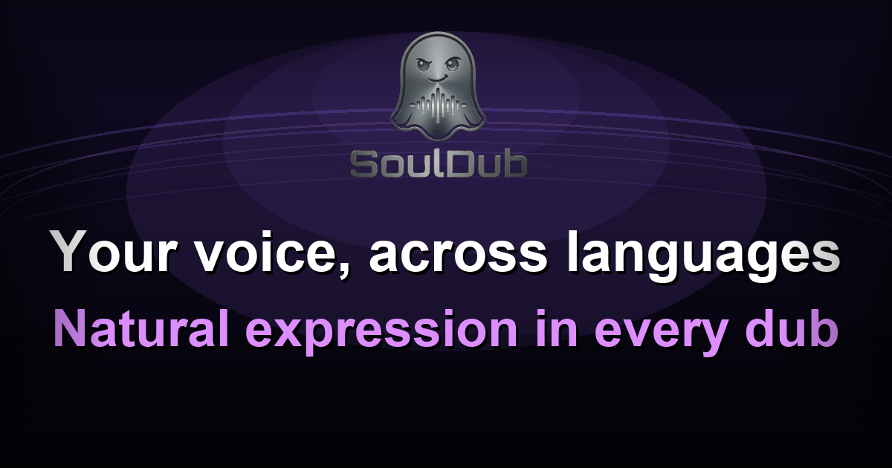

# SoulDub AI Video Translation Skill for AI Agents

[English](README.md) | [简体中文](README.zh-CN.md) | [Español](README.es.md) | [ไทย](README.th.md)

<p align="center">
  
</p>

แปลวิดีโอ MP4 ในเครื่องด้วยการแปลวิดีโอและการพากย์เสียงต้นฉบับด้วย SoulDub AI จากนั้นดาวน์โหลดวิดีโอที่แปลแล้ว คำบรรยายภาษาปลายทาง และคำบรรยาย SRT แบบสองภาษา

รีโพซิทอรีนี้เผยแพร่ Agent Skill ชื่อ `souldub-video-translate`

ใช้ Skill นี้เมื่อคุณต้องการให้เอเจนต์แปลหรือปรับเนื้อหาวิดีโอ MP4 พากย์วิดีโอเป็นภาษาอื่น แปลคำบรรยาย หรือสร้างคำบรรยายสองภาษาเพื่อตรวจสอบ

## ความสามารถ

Skill นี้ช่วยให้เอเจนต์สามารถ:

- อัปโหลดวิดีโอ `.mp4` จากเครื่องไปยัง SoulDub
- สร้างงานแปลวิดีโอ
- ติดตามความคืบหน้าของงานแปลที่ใช้เวลานาน
- ดาวน์โหลดวิดีโอที่พากย์ด้วย AI และคำบรรยาย SRT

เมื่อทำงานสำเร็จ จะบันทึกไฟล์ดังนี้:

- `result.mp4`: วิดีโอที่แปลแล้ว
- `translated.srt`: คำบรรยายภาษาปลายทาง
- `bilingual.srt`: คำบรรยายสองภาษา

## การติดตั้ง

ติดตั้งจากรีโพซิทอรี GitHub สาธารณะ:

```bash
npx skills add jiabaogithub/souldub-skills --skill souldub-video-translate
```

## การใช้งาน

หลังติดตั้ง ให้ขอให้เอเจนต์ใช้ Skill พร้อมระบุพาธไฟล์ MP4 ในเครื่องและภาษาปลายทาง:

```text
ใช้ souldub-video-translate skill เพื่อแปล C:\path\to\video.mp4 เป็นภาษาญี่ปุ่น
```

ตัวอย่างคำสั่งอื่น:

```text
ใช้ souldub-video-translate skill เพื่อพากย์ MP4 นี้เป็นภาษาจีน
ใช้ souldub-video-translate skill เพื่อแปลวิดีโอนี้และสร้างคำบรรยายสองภาษา
```

Skill รองรับชื่อภาษาหลายรูปแบบ เช่น `Japanese`, `Chinese`, `日语`, `中文` และ `粤语`

เอเจนต์จะขอข้อมูลที่จำเป็นเพิ่มเติม เริ่มงานแปล รายงานความคืบหน้า และส่งคืนพาธไฟล์ผลลัพธ์ในเครื่องเมื่อเสร็จสิ้น

## การตั้งค่า

Skill นี้ต้องใช้คีย์ API ของ SoulDub

หลังติดตั้ง ให้ขอให้เอเจนต์ตรวจสอบการยืนยันตัวตน:

```bash
uv run scripts/video_translation.py auth status
```

หากยังไม่ได้ตั้งค่าคีย์ API Skill จะสร้างไฟล์กำหนดค่าระดับผู้ใช้:

```text
~/.souldub/souldub.config.yaml
```

ตั้งค่า `souldub_api_key` ในไฟล์ดังกล่าว หรือตั้งค่าตัวแปรสภาพแวดล้อม `SOULDUB_API_KEY`

## ข้อกำหนด

- Python 3.11+
- `uv`
- การเชื่อมต่อเครือข่ายไปยัง SoulDub Agent API
- คีย์ API ของ SoulDub
- สิทธิ์อ่านไฟล์ MP4 ต้นฉบับ
- สิทธิ์เขียนในไดเรกทอรีผลลัพธ์

## ข้อมูลรันไทม์และความปลอดภัย

ไฟล์ Skill ที่ติดตั้งจะถือเป็นไฟล์แบบอ่านอย่างเดียว

สถานะรันไทม์จะเก็บไว้ในไดเรกทอรีสถานะของแพลตฟอร์มผู้ใช้ ผลลัพธ์ที่แปลแล้วจะบันทึกโดยค่าเริ่มต้นไว้ในโฟลเดอร์ `souldub_outputs/` ข้างไฟล์วิดีโอต้นฉบับ

Skill จะไม่บันทึกคีย์ API, URL อัปโหลดแบบมีลายเซ็น, URL มีเดียเกตเวย์ หรือพารามิเตอร์ลายเซ็นชั่วคราวแบบถาวร

## การพัฒนา

โครงสร้างรีโพซิทอรี:

```text
skills/
└── souldub-video-translate/
```

จากไดเรกทอรีรากของรีโพซิทอรี ให้ตรวจสอบการค้นพบในเครื่อง:

```bash
npx skills add . --list
```

ติดตั้งสำเนาที่กำลังพัฒนาในเครื่อง:

```bash
npx skills add . --skill souldub-video-translate
```

เรียกใช้สคริปต์ช่วยเหลือโดยตรงเพื่อดีบักในเครื่อง:

```bash
cd skills/souldub-video-translate
uv run scripts/video_translation.py auth status
```
